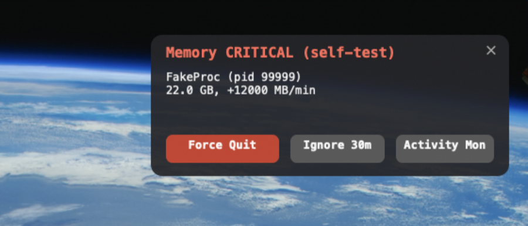
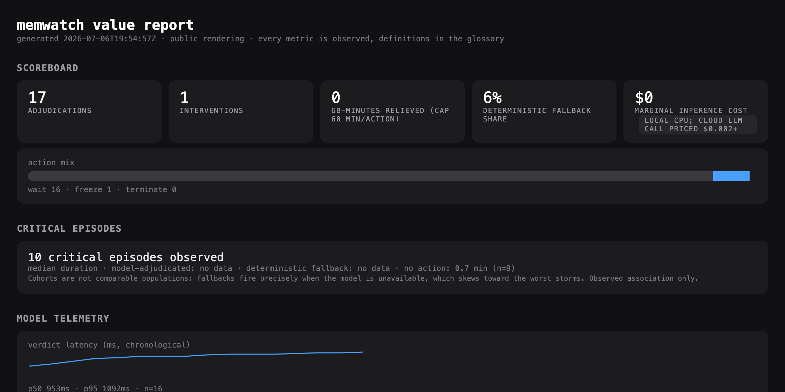

# memwatch

A menu-bar memory early-warning system for macOS, driven by Hammerspoon. It
exists to prevent a repeat of the 2026-05-29 unrecoverable freeze (a
memory-compressor thrash livelock on this 36 GB machine) and the 2026-07
Chrome runaway that nearly repeated it: detect that memory demand is actively
degrading the system while there is still headroom, name the runaway process
immediately, and end it in one click.

## The model: dynamics, not levels

Absolute compressor and swap sizes are useless as alarms on macOS. They are
cumulative and homeostatic: the kernel will happily hold 30 GB in the
compressor and 8 GB of swap for days while reporting normal pressure, and it
defends a low free-page equilibrium by design. A gauge keyed to absolute
levels goes red and stays red, which is the same as never alerting at all.

What actually predicts the beachball is motion:

| Signal | Source | Why it matters |
|--------|--------|----------------|
| Swap-out rate | `swapOuts` counter delta (native `hs.host.vmStat()`) | sustained disk eviction means the compressor is full; a storm is the thrash signature |
| Compression rate | `pagesCompressed` counter delta | how hard the compressor is being fed right now |
| Kernel pressure level | `sysctl kern.memorystatus_vm_pressure_level` | the OS's own verdict (1 normal / 2 warn / 4 critical) |
| Available headroom | free + speculative + purgeable + file-backed pages | only meaningful paired with active compression, never alone |
| Per-process growth | footprint weight per pid: `ps` RSS + sticky per-pid compressed size from `top` | the runaway catcher: what is CLIMBING, not what is big; weight stays visible even when the kernel compresses a fast allocator's pages away in real time |

## States

An always-present dot in the menu bar, quiet until something is wrong:

| State | Look | Enters when (confirmed over consecutive ticks) |
|-------|------|-----------------------------------------------|
| `ok` | dim green dot, no text | default |
| `elevated` | amber dot, watch hint (`● Chrome↑`) when a grower is watched | kernel warn, sustained swap-out, compression storm, or thin headroom under active compression (~10s confirm) |
| `critical` | red dot naming the offender (`● Chrome 22G`) or the cause (`● SWAP`) | swap-out storm or floor-level headroom under compression (~10s); kernel critical or a confirmed extreme runaway immediately |

Downgrades are deliberately slower than upgrades: a minimum dwell (30s out of
critical, 20s out of elevated) plus consecutive genuinely-calm ticks with exit
thresholds below entry thresholds. The state cannot flap.

## Runaway detection

Per-pid footprint-weight history rings (RSS plus that pid's compressed size,
sticky between `top` refreshes), judged over the rising tail so an old flat
stretch never dilutes a fresh climb. One flat tick between rises is tolerated
(the compressed component refreshes on `top`'s slower cadence); two
consecutive flats or any real drop end the streak:

- **Extreme growth** (>= 150 MB/s across ~20s of climb, or >= 6 GB net window
  growth while still climbing): fires even while the system is still `ok`
  and forces `critical`. This is the Chrome-runaway catcher; the point is to
  act while there is headroom left. An extreme verdict latches for 45s: RSS
  collapsing because the kernel is compressing the runaway must never read
  as recovery. A killed pid still clears the books within two ticks
  (runaways are only reported for pids seen alive in the last 12s).
- **Sustained growth** (>= 1.5 GB/min across ~20s): a watch (amber hint) while
  the system is `ok`, an alert once it is `elevated`.
- **Absolute footprint** (>= 40% of RAM by weight): attribution only while the
  system is already `critical`. A steady 20 GB local model server never
  alarms on size.
- **No proven runaway at `critical`**: the largest process by weight is named
  as attribution, explicitly tagged "largest process, not growing" on every
  surface, and the menu-bar title shows the systemic cause (`● SWAP`) instead
  of the bystander's name.

Hog ranking joins fresh `ps` RSS with the top stream's per-process `CMPRS`:
a runaway whose pages were compressed away shows a small RSS and a huge
CMPRS, so RSS-only lists mislead exactly when it matters. pid reuse is
detected by a comm change and resets that pid's history.

## Alerts and one-click kill

On `critical` (or an extreme runaway), a small floating HUD appears under the
menu bar on every Space, without stealing keyboard focus:



**Force Quit** sends SIGTERM immediately (no confirmation), escalates to
SIGKILL after 7s if the target refuses to die, verifies death, and reports the
memory actually reclaimed. Safety rails, enforced in pure logic
(`core.killAllowed`): same-uid processes only, a curated denylist
(WindowServer, loginwindow, Finder, Dock, Hammerspoon itself, and friends),
never pid 1, never memwatch's own host. Every alert action acts on an
identity, never a name: when an alert first shows a process it binds that
process's start time, and the target is re-validated against it before TERM
and again before KILL, so a recycled pid is refused rather than signaled.
Every probe carries a positive control, so a probe that cannot run under
pressure is never read as "the process exited": nothing is signaled, the
frozen ledger keeps its entry, and the action stays retryable. If the
binding fails, the HUD's first click binds it and asks for a second click
("Identity verified. Click again to act."); unattended action waits for it
too. A refusal on any surface (HUD, banner or menu) rebinds every surface.
The menu's process rows bind when the menu opens and offer no Freeze or
Force Quit for a row they cannot verify. Every action, refusal and answer
is logged.

Each alert answers for one process, by what its action actually did. If a
different process takes over as the offender while the HUD is up, the HUD
switches to it as a new alert. The close button means "not now": the same
process returns after the raise cooldown, as a new alert, or at once if it
escalates (a quiet hog turning into a runaway). A process memwatch holds
frozen, that is gone, or that is ignored (**Ignore 30m**, for 30 minutes) is
no candidate for the HUD, the banner or the largest-process fallback; a
process that survives a Freeze or Force Quit comes back after the
cooldown, and a resumed one is alertable again. The full rules are in
[docs/alert-lifecycle.md](docs/alert-lifecycle.md).

A notification breadcrumb accompanies the HUD: one banner per offender per
critical episode, never re-posted for the same offender within the episode
(even after a manual dismissal), and withdrawn on its own once the state
settles below critical. A generic banner (no offender identified yet) is
replaced in place as soon as one is named. When the named offender changes,
the stale banner is withdrawn at once and its replacement follows after a
cooldown that damps offender flap. Its Force Quit action button appears only
once the offender's start time is bound (the banner is upgraded in place when
it binds), and renders reliably only when Hammerspoon notifications are set
to the Alerts style; the HUD is the dependable surface.

**Desktop alerts: on/off** in the menu mutes both surfaces at will
(persisted as `"alerts": false` in `memwatch-local.json`; CLI:
`hs -c "memwatch.setAlertsEnabled(false)"`). Muting hides the HUD and the
banners only: the menu-bar state icon, logging, and the unattended engine
stay live, and action receipts (an autonomous freeze/quit, frozen processes
surviving a reload, the adjudicator killed for exceeding its memory budget)
still notify, as does the page that says per-process detection has gone
stale while pressure is up (it stays up until detection recovers). Unmuting
during an episode restores its HUD and banner.

The dropdown menu shows the state and its cause, kernel level, live rates,
headroom, top-5 processes by true weight (each with Freeze / Force Quit /
Ignore submenus), direct Force Quit / Ignore items for the current
offender, and the desktop-alerts / LFM toggles.

### Freeze (reversible)

Alongside Force Quit, the HUD and menu offer **Freeze**: a SIGSTOP that
pauses a process instantly and reversibly. It does not release the memory
(that happens on resume or quit), but it stops the growth with nothing
lost, which is the right first move for a process you are not ready to
kill. Frozen processes are tracked in a ledger that survives a Hammerspoon
reload with a start-time identity check, so nothing is ever left paused and
orphaned, and a "Frozen by memwatch" menu section resumes them.

### Unattended modes (opt-in, default OFF)

`core.cfg.unattended = "off" | "freeze" | "kill"` (or the local config file)
arms an unattended guard for the away-from-keyboard case: an extreme-growth
runaway while critical, whose alert has gone unanswered for the grace window
(muted desktop alerts still arm and count the same clock), is frozen or
killed through the same policy-checked flow, loudly logged and notified.
The grace is per process: the time that process has headed the alert as a
runaway, so a newly named offender, a hog that turns into a runaway, or two
runaways trading the top spot each get a full window. An operator action
on that process from any surface stands it down; a click that did nothing
does not. A freeze or terminate that fails on a process is not retried on
it, and the receipt says what happened. `freeze` is the recommended
reversible default. The legacy `autoKill = true` still works and maps to
`unattended = "kill"`. Leave it off until the detector has earned your
trust.

### LFM adjudication (opt-in, default OFF)

An optional on-device LFM2.5 model can adjudicate the unattended decision,
choosing wait, freeze, or terminate inside the deterministic rails at zero
marginal cost. It is off by default; a plain install is exactly the
deterministic sentinel. Enable with `./install.sh --with-lfm` or the menu
toggle. See [docs/lfm-adjudication.md](docs/lfm-adjudication.md) and the
[bake-off methodology](docs/bakeoff-methodology.md); the model weights are
licensed separately (`NOTICE-LFM`).

Every adjudication lands in a local decision ledger, and the **Open value
report** menu item renders it into a self-contained dashboard with every
metric operationally defined:



### Observation ledger (passive, default ON)

Independently of adjudication, memwatch keeps a passive observation ledger,
`memwatch-observe.jsonl` (local and gitignored). It writes a row at each
grace-expiry decision point, and every 45 s while pressure is up and an
offender is named. A decision point is a tick where the live unattended gate
stands open, whatever the unattended mode: an extreme runaway, surfaced by
the alert, unanswered for its grace window, and not frozen, gone or ignored.

Each row holds:
- the exact redacted, pid-free snapshot a model would have received (a row
  that would exceed 60 KB drops it and carries `snapshotDropped`);
- `wouldAct`, the action the deterministic policy fires under the live mode
  (`none` while unattended is off, and on every 45 s row);
- at decision points, `wouldActAtFreeze`, the freeze-ceiling counterfactual
  a model would own at grace expiry.

`offender.foreground` is a fork-free name match (`foregroundBasis: "name"`).
The live policy also walks the process tree, so under kill mode `wouldAct`
can read terminate where the live policy would freeze. `offender.name` is a
sanitized local basename kept only to re-derive categories: like the row's
`pid`, it is never model input and is stripped from any dataset built from
the ledger. Rows carry a `session` id. The sequence number restarts on every
reload, so `(session, seq)` joins a row to its follow-ups.

Follow-ups at 60, 120 and 180 s record what actually became of the process
and the machine. Each observation keeps its own evidence, folded in as
events arrive: every process sample, every signal memwatch sends and every
operator action aimed at that same process (matched by its start time, so a
process that later takes the pid is never mistaken for it). A follow-up
reads only that record.

The fate is one of:
- `alive`: seen as the same process in a sample read within 15 s of the
  horizon (freshness counts from when the table was read, not when it
  arrived);
- `exited`: proven gone by a sample (detail `pid-reused` when another
  process holds the pid);
- `frozen`: alive, and memwatch's frozen ledger holds this same process;
- `unknown`: details `stale-sample`, `incomplete-sample` or
  `identity-uncertain`.

Each follow-up also carries:
- the weight, and `peakSinceMB` (kept even if the process leaves the
  tracker);
- `sampleAgeSec`;
- available memory, and kernel jetsam reports by file time;
- `frozenLedger`;
- `operatorActionsSince` (any operator action) and `operatorTouchesSince`
  (actions on this process);
- `memwatchSignalSince`, a terminate or freeze memwatch itself sent to this
  process, so its own actions never read as natural exits.

Pending follow-ups do not survive a reload.

It never forks, never acts and never leaves the machine. It exists so that
adjudicators can be judged against real outcomes rather than synthetic
scenarios alone. Set `"observe": false` in the local config to turn it off.
`hs -c "memwatch.testObserve()"` writes one synthetic-tagged row to prove the
path end to end, and says so if the row could not be written.

## Layout

```
~/projects/memwatch/
  lua/memwatch_core.lua   pure: metrics, rates, signals, state machine, title, kill policy
  lua/memwatch_procs.lua  pure: ps/top parsers, growth rings, runaway detection, ranking
  lua/memwatch_lfm.lua    pure: LFM JSON codec, prompt, serializer, validator, rails (opt-in)
  lua/memwatch_report.lua pure: the value report renderer (opt-in)
  lua/memwatch_observe.lua pure: observation-ledger rows, per-observation evidence and fates
  lua/memwatch.lua        Hammerspoon glue: timers, async sampling, HUD, menu, kill/freeze, LFM lifecycle, log
  test_core.lua           unit tests for the pure modules (lua test_core.lua)
  test_report.lua         unit tests for the report renderer (lua test_report.lua)
  test_glue.lua           behavioral tests of the alert glue in a fake Hammerspoon (lua test_glue.lua)
  test/hsfake.lua         that fake: virtual clock, timers, process table, HUD, banners, menu
  docs/alert-lifecycle.md the alert rules: identity, answers, grace, banners, episode boundaries
  eval/                   the model bake-off: corpus, runner, gates, methodology
  install.sh              idempotent wiring into ~/.hammerspoon/init.lua (with backup); --with-lfm adds adjudication
  memwatch.log            state transitions, runaways, kills, errors; rotates at 1 MB
  memwatch-observe.jsonl  passive observation ledger; rotates at 4 MB, three generations kept
```

The verdict is fork-free: signals and the state machine run every 5s tick
from native `hs.host.vmStat()` counters plus the last-known kernel level, so
the gauge keeps deciding while the system is dying. Enrichment arrives on two
async feeds: a consolidated `sysctl` + full `ps` fork per tick (streaming
drain, in-flight guard, watchdog; a failed or starved fork degrades to stale
process data, never to a wrong verdict, and the menu says so), and a single
persistent `top -l 0` stream, spawned at the onset of pressure while spawning
still works, feeding per-pid footprint (MEM + CMPRS) right through a storm in
which forking anything new starves for tens of seconds. Live drills measured
every one of those failure modes before this shape settled.

## Install

Requires [Hammerspoon](https://www.hammerspoon.org). The install script wires
`~/projects/memwatch`, so clone to that path:

```sh
git clone https://github.com/rgsuarez/memwatch.git ~/projects/memwatch
bash ~/projects/memwatch/install.sh
```

Appends a `BEGIN memwatch / END memwatch` block to `~/.hammerspoon/init.lua`
(after backing it up), adds the project `lua/` dir to `package.path`, and
`require("memwatch")`, then reloads Hammerspoon. Re-running is safe.

## Test

Pure-logic unit tests (state machine, detector, kill policy, parsers), and
behavioral tests that run the real Hammerspoon glue against a fake
Hammerspoon with a virtual clock (alert episodes, identity binding, failed
probes, answers and grace, banners, restarts, diagnostics):

```sh
cd ~/projects/memwatch && lua test_core.lua && lua test_glue.lua
```

The fake writes into a scratch home under the system temp dir; set
`HSFAKE_ROOT` (or run where `$PWD` is writable) when that is not allowed.

The public-tree firewall refuses to scan without the maintainer's local term
list, so a public clone runs it as
`MEMWATCH_PUBLIC_CLONE=1 bash eval/checks/no-internal-refs.sh`.

Visual self-test and full-surface simulation (no real process involved; the
fake offender is synthetic, so its buttons never signal anything, whatever
process may really hold its pid):

```sh
hs -c "memwatch.test('elevated')"    # amber title for 12s
hs -c "memwatch.test('critical')"    # red title + notification + HUD
hs -c "memwatch.simulate()"          # runaway-alert demo for 20s
hs -c "memwatch.status()"            # one-line current reading
hs -c "memwatch.testObserve()"       # one synthetic observation row, follow-ups at 2-6 s
```

Live end-to-end drill with a real (bounded, safe) leaker: allocate ~190 MB/s
up to an 8 GB cap, watch the HUD name `python3` within ~40s, and click Force
Quit:

```sh
python3 -c 'import time
a = []
step = 48 * 1024 * 1024
while len(a) * step < 8 * 1024**3:
    a.append(bytearray(step)); time.sleep(0.25)
print("holding", flush=True); time.sleep(600)'
```

## Uninstall

Delete the `BEGIN memwatch ... END memwatch` block from
`~/.hammerspoon/init.lua` (a backup `init.lua.bak.*` was created at install
time) and reload Hammerspoon.

## Notes

- Auto-starts at login because Hammerspoon does; no launchd job.
- Alerts are silent by design (icon + HUD + notification, no sound), and the
  HUD + banners can be muted at will from the menu (`Desktop alerts: off`).
- The dot is steady by default; `core.cfg.flash = true` restores the pulse.
- Editing the module does not auto-reload (the pathwatcher only watches
  `~/.hammerspoon/`); run `hs -c "hs.reload()"` after changes.
- All thresholds live in `M.cfg` tables at the top of the two pure modules,
  sized for a 36 GB machine under a heavy dev workload (agents, node, Chrome,
  Notion); scale the rate and growth numbers with RAM if this ever moves.

## License

Code: MIT. See [LICENSE](LICENSE).

The optional LFM adjudication feature downloads model weights separately at
install time; those are licensed under the LFM Open License v1.0, not MIT.
See [NOTICE-LFM](NOTICE-LFM) and
[licenses/LFM-Open-License-v1.0.txt](licenses/LFM-Open-License-v1.0.txt).
